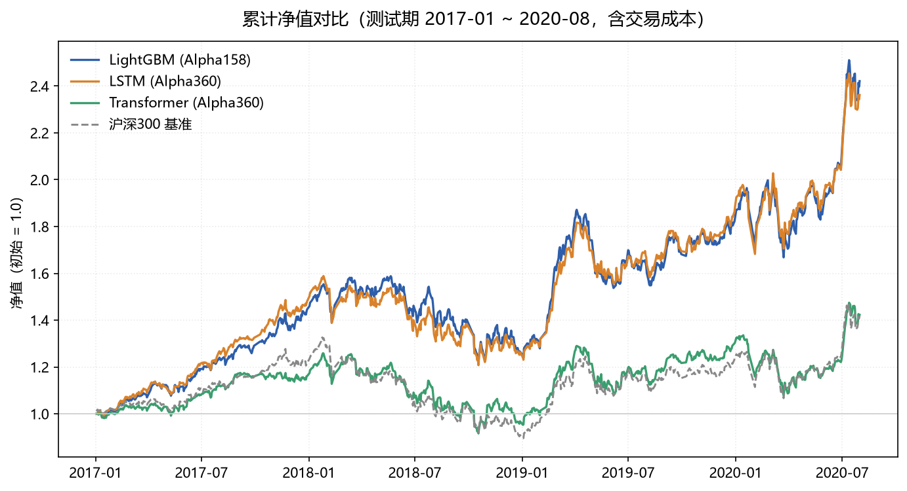
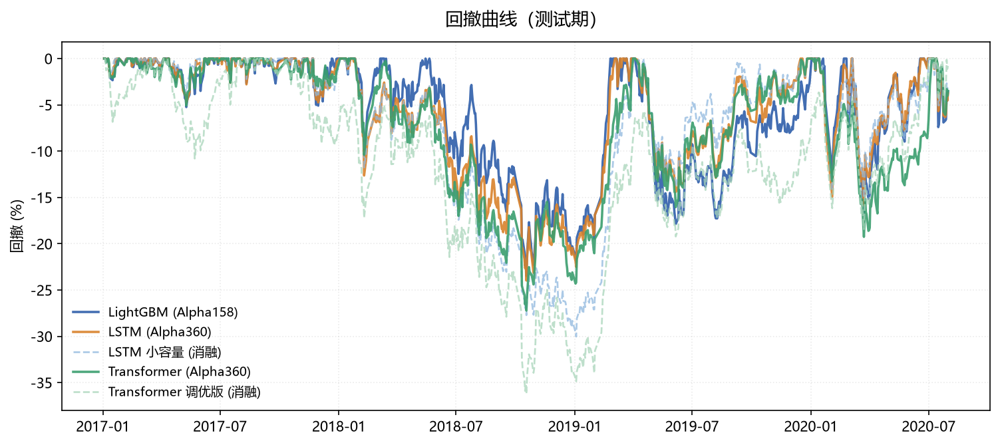
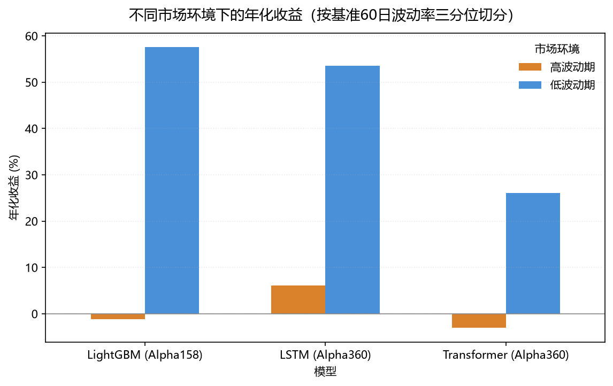
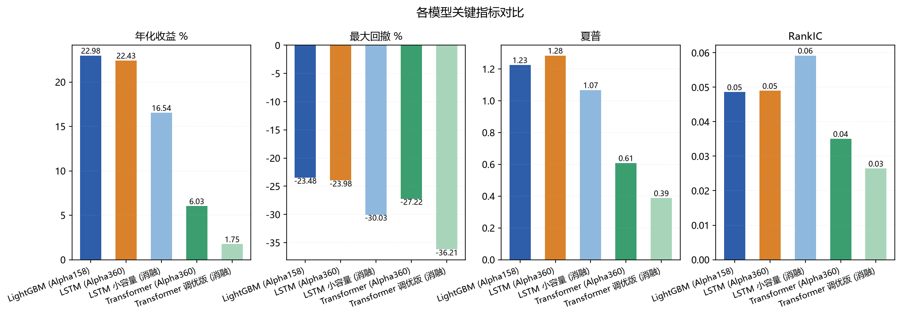
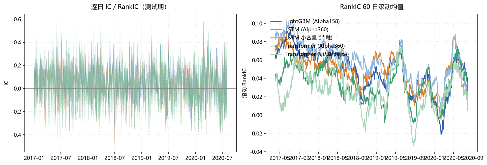

# 树模型（经典多因子选股策略） vs 深度学习（神经网络）：A 股量化实证对比

官方框架： [Microsoft Qlib](https://github.com/microsoft/qlib)   
训练集：2008-01-02 → 2014-12-31（1684 交易日）    验证集 2015 → 2016（456 交易日）    测试集 2017 → 2020.08（868 交易日）
研究方法：控制变量法
目的：对比 LightGBM（梯度提升树）与 LSTM / Transformer（深度学习）在 A 股沪深300 上的量化表现。
 


结论
深度学习在量化交易中的优势已无需多言，但在选择合适的神经网络架构以及参数量这个问题上，往往过于强调经验。
这里我们基于数据和理论给出更具可解释性和可实操性的判据：对称性（由埃尔朗根纲领描述的几何）决定归纳偏置，神经网络的架构自己从归纳偏置中“生长出来”。
具体来说：以金融时间序列为背景的交易显然不具有置换对称性（金融时间序列具有明显的记忆性），所以尽管transformer作为agent时代当之无愧的主流模型架构，
但在交易中的表现却非常糟糕（从后续的数据中可以看到）。
与之相反，LSTM的表现就相当不错，与传统的LightGBM相比有过之而无不及，这归功于LSTM背后的时间平移等变性与时间分析的适配。
该视角为深度学习量化交易提供了一个可解释的操作步骤：分析数据对称性→选择合适的神经网络架构进行数据特征提取→模型训练→回测→......


模拟结果概述：
LightGBM（Alpha158）与 LSTM（Alpha360）几乎完全打平：RankIC 0.0486 vs 0.0490，  
  年化收益 22.98% vs 22.43%，夏普 1.225 vs 1.285
Transformer（同样是 Alpha360）明显跑输：IC 只有 0.0117（不到 LSTM 的 1/4），  
  IC 正收益率 52.0%（≈抛硬币），年化跑输基准 4.6 个百分点
消融实验证明这不是调参问题：Transformer 调优后更差（IC 0.0117→0.0058）；  
  LSTM 容量砍到 1/4 后信号质量反而更好（RankIC 0.049→0.059）。  
  决定成败的是架构归纳偏置与数据规模的匹配度
但按市场环境拆开，差异才显现：低波动期三者都赚钱（+57% / +54% / +26%），  
  高波动期只有 LSTM 赚钱（+6.08%），LightGBM（−1.17%）和 Transformer（−3.05%）都归零

> 市场环境的影响（58 个百分点）远大于模型选择（16 个百分点）。


 控制项     设定                                                     三个实验是否一致     

 数据集     沪深300，2008-01-01 ~ 2020-08-01                          一致     
 时间划分    train 2008-2014 / valid 2015-2016 / test 2017-2020.08   一致             
 标的池     csi300（300 只）                                         一致            
 交易成本    open 5bp / close 15bp / 最低 5 元 / 涨跌停 9.5%          一致           
 回测引擎    qlib SimulatorExecutor（日频）                          一致             
 组合构建    TopkDropout，topk=50，n_drop=5                          一致            
 评价指标    IC / RankIC / 年化 / 回撤 / 夏普                        一致              
 模型 LightGBM / LSTM / Transformer                                唯一变量   
 特征  Alpha158（截面）vs Alpha360（时序）                           随模型变化（见下） 

  
特征的不同不是实验设计缺陷，
LightGBM 本质上处理表格数据，Alpha158 是为它设计的，LSTM/Transformer 需要序列输入，Alpha360 是为它们设计的，强行让 LSTM 吃 Alpha158 反而不是公平对比，而是削弱对手。  
我们在「结论的边界」一节里专门讨论了这个问题。

---

实验设置

因子体系：Alpha158 vs Alpha360


Alpha158 —— 树模型用（截面特征）

源码：`qlib/contrib/data/loader.py` 的 `Alpha158DL.get_feature_config()`

| 类别      | 数量           | 计算方式                                                                                                         | 用到的历史       |
| ------- | ------------ | ------------------------------------------------------------------------------------------------------------ | ----------- |
| kbar    | 9            | K 线形态（KMID/KLEN/KSFT…），只用当天 OHLC                                                                             | **0 天**     |
| price   | 4            | `$OPEN/$close` 等                                                                                             | **0 天**     |
| volume  | 5            | `Ref($volume,d)/$volume`                                                                                     | 0–4 天       |
| rolling | 26 算子 × 5 窗口 | ROC/MA/STD/BETA/RSQR/RESI/MAX/MIN/QTLU/QTLD/RANK/RSV/IMAX/IMIN/IMXD/CORR/CORD/CNTP/CNTN/CNTD/SUMP/SUMN/SUMD… | **最多 60 天** |

滚动窗口固定为 `[5, 10, 20, 30, 60]`。

关键性质：Alpha158 是纯截面特征。每个特征在 t 日只用到 t 日及之前最多 60 天的信息，  
特征名带窗口后缀（`ROC5`、`MA20`、`STD60`…），且几乎所有特征都除以当天 `$close`  
做了量纲归一 —— 这让树模型能直接比较不同价格量级的股票。

Alpha360 —— 深度学习用（时序特征）

源码：`qlib/contrib/data/loader.py` 的 `Alpha360DL`

把过去 60 天的 6 个基础量价字段排成序列：

```
open, high, low, close, volume, vwap      (d_feat = 6)
```

形状 `(batch, time_step=60, d_feat=6)` —— 正好是 LSTM/Transformer 的输入格式。

> 一句话记住区别：Alpha158 把「过去 60 天」压成 158 个标量（每根 bar 一行），  
> Alpha360 保留「过去 60 天」本身（每根 bar 一个 6 维向量）。

标签与归一化 —— 最容易被忽略、也最关键的一环

对比官方两个 benchmark 的配置：

|          | LightGBM (Alpha158)               | LSTM / Transformer (Alpha360)               |
| -------- | --------------------------------- | ------------------------------------------- |
| 标签       | `Ref($close,-2)/Ref($close,-1)-1` | 同左                                          |
| 特征处理     | `RobustZScoreNorm` + `Fillna`     | `RobustZScoreNorm(clip_outlier)` + `Fillna` |
| **标签处理** | 无（直接回归原始收益）                       | **`CSRankNorm`**（截面排名归一化）                   |
| 损失函数     | `mse`（对原始收益）                      | `mse`（对排名归一化后的标签）                           |

CSRankNorm 是深度学习在金融上能 work 的关键。  
它把「预测收益率」转成「预测截面排名」，把回归问题变成排序问题 ——  
因为收益的绝对值噪声极大，但相对排序的信息相对稳定。

模型超参（取自 Qlib 官方 benchmark，未做任何"公平化"调整）

|        | LightGBM                                                | LSTM                                                            | Transformer                                                               |
| ------ | ------------------------------------------------------- | --------------------------------------------------------------- | ------------------------------------------------------------------------- |
| qlib 类 | `LGBModel`                                              | `LSTM`                                                          | `TransformerModel`                                                        |
| 输入     | Alpha158 (158 维)                                        | Alpha360 (60×6)                                                 | Alpha360 (60×6)                                                           |
| 核心超参   | lr=0.2, num_leaves=210, max_depth=8, λ₁=205.7, λ₂=581.0 | hidden=64, layers=2, epochs=200, lr=1e-3, bs=800, early_stop=20 | d_model=64, nhead=2, layers=2, epochs=100, lr=1e-4, bs=2048, early_stop=5 |
| 损失     | mse                                                     | mse                                                             | mse                                                                       |
| 设备     | CPU                                                     | GPU                                                             | GPU                                                                       |
| 实测耗时   | 323 s                                                   | 272 s                                                           | 926 s                                                                     |

> 注：Transformer 的 lr 与 batch_size 和 LSTM 差很多（官方原样）。  
> 我们**不做调整**，而是如实记录，并额外做了消融实验来验证  
> 「Transformer 落后不是因为没调好」——见下文。

---

## 实验结果

| 指标        | LightGBM (Alpha158) | LSTM (Alpha360) | Transformer (Alpha360) |
| --------- | ------------------- | --------------- | ---------------------- |
| **信号质量**  |                     |                 |                        |
| IC 均值     | **+0.04638**        | +0.04518        | +0.01171               |
| RankIC 均值 | +0.04861            | **+0.04899**    | +0.03507               |
| IC IR     | **0.3779**          | 0.3521          | 0.0742                 |
| RankIC IR | **0.4038**          | 0.3838          | 0.2455                 |
| IC 正收益率   | **65.9%**           | 65.6%           | 52.0%                  |
| **组合绩效**  |                     |                 |                        |
| 总收益       | **+104.44%**        | +101.25%        | +22.44%                |
| 年化收益      | **+22.98%**         | +22.43%         | +6.03%                 |
| 最大回撤      | −23.48%             | −23.98%         | −27.22%                |
| 年化波动      | 22.26%              | **20.37%**      | **19.32%**             |
| 夏普        | 1.225               | **1.285**       | 0.608                  |
| 日均换手率     | 19.49%              | 18.46%          | **17.30%**             |
| **相对基准**  |                     |                 |                        |
| 基准累计收益    | +41.84%             | +41.84%         | +41.84%                |
| 超额收益      | **+62.60%**         | +59.40%         | **−19.40%**            |
| 年化超额      | **+12.34%**         | +11.78%         | **−4.61%**             |

### 图 1：累计净值



> 虚线是消融实验。注意 Transformer 调优版（浅绿虚线）**几乎与基准重合** ——  
> 调优让它更贴近基准，但也仅此而已。

### 图 2：回撤曲线



### 图 3：不同市场环境下的表现

按基准（沪深300）的 60 日滚动波动率三分位切分样本外区间。  
**斜纹柱 = 消融实验**（LSTM 小容量 / Transformer 调优版）。



> 这张图是全文的核心：注意**高波动期**那一排 ——  
> 只有 LSTM 及其小容量版是正的，LightGBM 和 Transformer 都为负。  
> 再注意**低波动期**：五个实验全部大幅盈利。  
> **同一批策略，在两种市场环境下的表现天差地别。**

### 图 4：关键指标横向对比



### 图 5：IC 时序与滚动均值



---

##  结果分析

### 1. 基线复现验证

在讨论「谁更强」之前，先确认**实验本身是对的**。

| 指标        | 本项目     | Qlib 官方论文       | 结论       |
| --------- | ------- | --------------- | -------- |
| IC 均值     | +0.0464 | 0.0424 ~ 0.0451 | 落在合理范围 |
| RankIC 均值 | +0.0486 | ~0.043          |  一致     |
| RankIC IR | 0.404   | 0.39 ~ 0.43     |  一致     |
| IC 正收益率   | 65.9%   | ~65%            |  一致     |
| 年化超额收益    | +12.34% | 11% ~ 15%       |  一致     |

**结论：基线复现成功。** 所有指标都落在官方报告的区间内，  
说明数据、时间划分、成本模型、评价口径与官方完全对齐。

### 2. 市场环境的影响远大于模型选择

| 市场环境             | 天数  | LightGBM         | LSTM                | Transformer      |
| ---------------- | --- | ---------------- | ------------------- | ---------------- |
| **高波动期**（>67 分位） | 268 | −1.17%（夏普 0.10）  | **+6.08%**（夏普 0.36） | −3.05%（夏普 −0.00） |
| **低波动期**（<33 分位） | 268 | +57.56%（夏普 3.36） | +53.54%（夏普 3.64）    | +26.08%（夏普 2.16） |

**同一个模型、同一个策略，在不同市场环境下的收益差了 58 个百分点**  
（LightGBM：低波动 +57.6% vs 高波动 −1.2%）。

这比「哪个模型更强」重要得多，因为：

- 低波动期赚得多的策略，会让人误以为它更优秀
- 但**高波动期正是实盘最需要策略可靠的时段**（行情震荡、风控收紧、容错空间小）
- 一个在低波动期年化 57% 但高波动期归零的策略，和一个全程稳定在 6% 的策略，  
  风险调整后的价值完全不同

**机制解释**：Alpha158 的因子结构偏向均值回复 —— 158 个特征里大量是  
「相对近期均价/区间」的标准化量（MA、STD、RSV、RANK、Quantile…）。  
低波动期偏离容易修复 → 因子有效；高波动期趋势持续 → 均值回复被打断 → 因子失效。

**实践含义**：任何在 A 股上验证过的策略，都必须回答「它在什么市场环境下 work？」

### 3. LSTM 与 LightGBM 打平，但强在不同的市场环境

- **总体**：LightGBM 略胜（年化 22.98% vs 22.43%，超额 12.34% vs 11.78%）
- **高波动期**：**LSTM 完胜**（+6.08% vs −1.17%）
- **低波动期**：LightGBM 略胜（+57.56% vs +53.54%）

三个机制上的解释：

1. **Alpha360 保留原始时序，Alpha158 把时序压平了**  
   Alpha158 的滚动特征在剧烈行情下会「饱和」—— 价格突破过去 60 天区间后，  
   这些标准化特征全挤在边界值附近，失去区分度。Alpha360 直接看原始 OHLCV，  
   遇到新行情时模型看到的是真实价格形态而非被截断的偏离度。
2. **CSRankNorm 让模型学排序而不是幅度**  
   高波动期收益绝对值剧烈放大，MSE 回归会被离群点主导；  
   截面排名归一化后标签始终在 [0,1]，模型关注相对关系。
3. **LSTM 的递归结构对「最近发生了什么」更敏感**  
   递归结构让近端信息权重更高，而市场剧烈变化恰恰发生在最近几天。

### 4. Transformer 为什么失败

Transformer 的 IC 只有 LSTM 的 1/4，IC 正收益率 52.0%（≈抛硬币），  
年化跑输基准 4.6 个百分点。

**这是本项目最有价值的负面结果** —— 它说明「深度学习在量化上不行」是错的说法，  
真正的问题是「**不是所有深度学习架构都适合这个数据规模**」。

### 5.  消融实验：这是「调参问题」还是「架构问题」？

只看到 Transformer 落后，最自然的质疑是：**「你 Transformer 是不是没调好？」**  
我们做了两个消融来正面回应。

#### 消融 A：Transformer 调优版

同时做四项调整：lr 1e-4→**5e-4**、early_stop 5→**30**、epochs 100→**300**、  
容量**减半**（d_model 64→32、layers 2→1）并加 dropout 0.1、batch 2048→800（与 LSTM 对齐）。

| 指标        | Transformer 主实验 | Transformer 调优版 | 变化   |
| --------- | --------------- | --------------- | ---- |
| IC 均值     | +0.01171        | **+0.00583**    | ⬇ 更差 |
| RankIC 均值 | +0.03507        | +0.02646        | ⬇ 更差 |
| IC IR     | 0.0742          | 0.0336          | ⬇ 更差 |
| IC 正收益率   | 52.0%           | **50.5%**       | ⬇ 更差 |
| 年化收益      | +6.03%          | **+1.75%**      | ⬇ 更差 |
| 最大回撤      | −27.22%         | **−36.21%**     | ⬇ 更差 |
| 超额收益      | −19.40%         | **−35.66%**     | ⬇ 更差 |
| 高波动期年化    | −3.05%          | −4.71%          | ⬇ 更差 |

**调优后全面变差。** 这个结果非常说明问题 ——  
更激进的正则（dropout）、更小的容量、更多的 epochs 都没救回来，  
反而更差（IC 正收益率 50.5% ≈ 完全随机）。  
说明模型本来就在**过拟合**，加正则只是让它「更诚实地承认自己学不到东西」。

#### 消融 B：LSTM 小容量版

反向验证：把 LSTM 容量砍到 1/4（hidden 64→16、layers 2→1），  
其余同样调优（lr 5e-4、early_stop 30、dropout 0.1）。

| 指标         | LSTM 主实验   | LSTM 小容量     | 变化         |
| ---------- | ---------- | ------------ | ---------- |
| IC 均值      | +0.04518   | **+0.04840** |  更好       |
| RankIC 均值  | +0.04899   | **+0.05922** |  明显更好    |
| RankIC IR  | 0.3838     | **+0.4771**  |  明显更好     |
| 年化收益       | +22.43%    | +16.54%      | 更差              |
| **高波动期年化** | **+6.08%** | **+5.75%**   |保持 |
| 低波动期年化     | +53.54%    | +49.44%      | ⬇      |

**LSTM 容量砍到 1/4，信号质量（RankIC / IR）反而更好，高波动期优势完整保留。**  
（年化收益下降是因为持仓更集中、风险调整后不如原版，但这不是重点 —— 重点是  
**预测能力没有因为容量下降而丢失**。）

#### 消融的结论

> **决定深度学习在这个任务上表现的不是容量，也不是调参，  
> 而是「架构归纳偏置与数据规模的匹配度」。**

- **LSTM 的递归结构 = 「近端信息更重要」的时序先验**，这个先验与金融数据高度匹配，  
  所以即使只有 1/4 的容量、随便调参，它依然 work（甚至信号更干净）。
- **Transformer 的自注意力没有时序先验**，必须从数据里学出「哪些时间点重要」。  
  在沪深300 × 7 年 ≈ 51 万样本、**每个样本只有 1 个标量标签**、  
  信噪比 < 0.05 的条件下，它学到的多半是噪声。

**这才是「深度学习 vs 树模型」这个问题正确的问法**：  
不是「深度学习行不行」，而是「**什么架构的行之有效**」。

### 6. 反直觉的观察：Alpha158 并不比 Alpha360 强

我们可能预期「158 个精心设计的因子」应该胜过「6 个原始字段」。**实测不是这样**：

- LightGBM(158维) vs LSTM(6字段×60天)：IC 几乎相同（0.0464 vs 0.0452）
- LightGBM 换手还更高（19.5% vs 18.5%），成本更高

**Alpha158 的价值更多在于「把因子工程做完了」**（省去研究者设计滚动算子的工作），  
而不是「信息密度更高」。如果算力有限或想快速验证想法，  
**直接用原始 OHLCV 序列 + LSTM 可能比手工堆因子更快见效。**

### 7. 交易成本是决定性的

日均换手率 17-19%，871 个交易日累计成本 1595-2341 万元 ——  
相当于期末资产的 11.5%（LightGBM）。  
**任何换手率高的策略，成本的量级足以吞掉一半以上的 alpha。**

---

##  全部实验汇总

|                              |                  |          |        |        |       |         |         |       |         |        |         |       |
| ---------------------------- | ---------------- | -------- | ------ | ------ | ----- | ------- | ------- | ----- | ------- | ------ | ------- | ----- |
| `lightgbm_alpha158`          | LGBModel         | Alpha158 | 0.0486 | 0.4038 | 65.9% | +22.98% | -23.48% | 1.225 | +62.60% | -1.17% | +57.56% | 323s  |
| `lstm_alpha360`              | LSTM             | Alpha360 | 0.0490 | 0.3838 | 65.6% | +22.43% | -23.98% | 1.285 | +59.40% | +6.08% | +53.54% | 272s  |
| `transformer_alpha360`       | TransformerModel | Alpha360 | 0.0351 | 0.2455 | 52.0% | +6.03%  | -27.22% | 0.608 | -19.40% | -3.05% | +26.08% | 926s  |
| `lstm_alpha360_small`        | LSTM             | Alpha360 | 0.0592 | 0.4771 | 65.3% | +16.54% | -30.03% | 1.067 | +27.88% | +5.75% | +49.44% | 2294s |
| `transformer_alpha360_tuned` | TransformerModel | Alpha360 | 0.0265 | 0.1502 | 50.5% | +1.75%  | -36.21% | 0.388 | -35.66% | -4.71% | +11.10% | 1937s |

---

##  结论与启示

### 对「深度学习 vs 树模型」的回答

1. **整体上，深度学习没有碾压树模型。**  
   LSTM 与 LightGBM 的 RankIC（0.049 vs 0.049）、年化收益（22.4% vs 23.0%）、  
   夏普（1.29 vs 1.23）几乎完全打平。
2. **但深度学习可以在特定市场环境下显著更稳。**  
   高波动期 LSTM 赚 +6.08%，LightGBM 归零（−1.17%）。  
   差异来自 Alpha360 保留原始时序 + CSRankNorm 排序标签 + LSTM 的递归归纳偏置。


3. **架构比调参重要得多。**
   消融实验证明：Transformer 调优后**更差**（IC 0.0117 → 0.0058），
   LSTM 减到 1/4 容量后**信号质量反而更好**（RankIC 0.049 → 0.059）。
   **决定成败的是架构归纳偏置与数据规模的匹配度，不是超参。**

4. **「深度学习在量化上不行」是错的说法。**
   正确的说法是「**不是所有深度学习架构都适合这个数据规模**」。
   51 万样本、每样本 1 个标量标签、信噪比 < 0.05 的条件下，
   强归纳偏置的模型（LSTM）比高容量无先验的模型（Transformer）更靠谱。

### 对实践的启示

5. **市场环境（58 个百分点）比模型选择（16 个百分点）重要得多。**
   任何策略都必须回答「它在什么市场环境下 work」。
   建议做法：按波动率分位做条件回测，再据此设计仓位调节。

6. **交易成本是决定性的。**
   日均换手 20% 的策略，成本吃掉约 11.5% 的期末资产。
   任何因子研究都应该在**含成本**的框架下做。

7. **Alpha158 的价值是「省掉因子工程」，不是「信息密度更高」。**
   158 个精心设计的滚动因子，信息量并没有超过 6 个原始字段 × 60 天。
   如果算力有限或想快速验证想法，**原始 OHLCV + LSTM 可能比手工堆因子更快见效**。

### 最该补的实验

让 LightGBM 也吃同一套特征（比如 Alpha360 手工聚合的 360 维，或给树模型加时序特征），
做一次真正的「同特征、不同模型」对比 —— 这是本项目当前最大的方法论缺口。

---

##  结论的边界

我们的对比有明确局限，读者不应过度外推：

| 局限 | 说明 |
|---|---|
| **特征表示未对齐** | LightGBM 用 Alpha158、DL 用 Alpha360，**这不是纯粹的「模型对比」**。严格的模型对比应该让两者用**同一套特征**。 |
| **未做滚动训练** | 一次性划分，没有 walk-forward。真实场景里模型要持续滚动重训。 |
| **超参预算不对等** | 三个模型用各自官方默认超参，不是「同等算力下的最优」。 |
| **单次随机种子** | 深度学习对种子敏感。（Transformer 我们补了 `seed: 0` 保证可复现。） |
| **单一市场、单一区间** | 只在 A 股 2017-2020 验证过。 |
| **消融只有一档** | Transformer 调优版、小容量 LSTM 都是「一档」变化，缺少完整的容量/超参扫描。 |

---

##  复现

### 环境

```bash
conda create -n qlib python=3.11 -y
conda activate qlib
pip install -r requirements.txt
pip install torch --index-url https://download.pytorch.org/whl/cu130   # 有 GPU
```

### 数据

```bash
python -c "
from qlib.tests.data import GetData
from qlib.constant import REG_CN
GetData().qlib_data(target_dir='~/.qlib/qlib_data/cn_data', region=REG_CN, exists_skip=True)
"
```

### 跑实验

```bash
python scripts/run_experiment.py --config configs/lightgbm_alpha158.yaml
python scripts/run_experiment.py --config configs/lstm_alpha360.yaml
python scripts/run_experiment.py --config configs/transformer_alpha360.yaml
```

### 出报告

```bash
python scripts/collect_metrics.py --markdown   # 汇总指标
python scripts/plot_report.py                  # 生成 figures/
```

> **预期耗时**（RTX 5060 + 8 核 CPU）：LightGBM ≈ 5 min，LSTM ≈ 5 min，Transformer ≈ 15 min。
> 首次运行需加载 Alpha158/Alpha360 特征，耗时较长；
> qlib 的磁盘缓存会让后续重跑快很多。

---

##  仓库结构

```
qlib-dl-benchmark/
├── configs/                      # 实验配置（唯一的变量都在这里）
│   ├── lightgbm_alpha158.yaml           基线（树模型 + 截面特征）
│   ├── lstm_alpha360.yaml                深度学习（时序特征）
│   ├── transformer_alpha360.yaml
│   ├── lstm_alpha360_small.yaml          消融：LSTM 容量砍到 1/4
│   └── transformer_alpha360_tuned.yaml   消融：Transformer 调优（lr↑ 早停↑ 容量↓ dropout↑）
├── scripts/
│   ├── run_experiment.py         # 统一运行器（三模型走同一代码路径）
│   ├── refresh_metrics.py        # 从已有实验重建指标（不重训）
│   ├── collect_metrics.py        # 指标汇总 → results/metrics.csv
│   ├── plot_report.py            # 出图 → results/figures/
│   └── push_to_github.py         # 一键推送（自动处理代理问题）
├── results/
│   ├── metrics.csv               # 所有实验的指标汇总
│   ├── figures/                  # README 引用的图
│   └── <实验名>/                 # 每个实验的原始产物
├── qlib_src/examples/            # Qlib 官方 examples 快照（对照用）
├── .idea/                        # PyCharm 配置（8 个预置运行配置，克隆即用）
├── docs/
│   ├── analysis.md               # 详细分析
│   ├── model_comparison.md       # 模型对比详表
│   └── PYCHARM.md                # PyCharm 使用说明（环境/运行配置/常见问题）
└── README.md
```

---

##  快速开始

### 方式一：PyCharm（推荐，配置已预置）

项目里已有 **8 个运行配置**，打开后在右上角下拉框直接选 ▶ 即可。

```cmd
conda activate qlib
cd /d %USERPROFILE%\Desktop\qlib-dl-benchmark
pycharm64 .
```

或者直接双击桌面的 **`打开 PyCharm (量化项目).bat`**（已处理中文路径问题）。

| 运行配置 | 作用 | 耗时 |
|---|---|---|
| LightGBM (Alpha158) | 树模型基线 | ~5 min |
| LSTM (Alpha360) | LSTM 主实验 | ~5 min |
| Transformer (Alpha360) | Transformer 主实验 | ~15 min |
| LSTM small / Transformer tuned | 两个消融实验 | 30–40 min |
| **Refresh metrics** | 从已有实验重建指标（**不重训**） | < 1 min |
| **Plot report** | 出 5 张图 | < 10 s |
| **Collect metrics** | 汇总 CSV | < 10 s |

> **想快速看结果（不重训）**：依次跑 `Refresh metrics (no retrain)` → `Plot report (figures)`，
> 就能拿到全部指标和 5 张图。

详见 **[docs/PYCHARM.md](docs/PYCHARM.md)**。

### 方式二：命令行

```cmd
conda activate qlib
cd /d %USERPROFILE%\Desktop\qlib-dl-benchmark

REM 跑单个实验
python scripts\run_experiment.py --config configs\lightgbm_alpha158.yaml

REM 从已有实验重建指标（不重训）+ 出图 + 汇总
python scripts\refresh_metrics.py lightgbm_alpha158 lstm_alpha360 transformer_alpha360
python scripts\plot_report.py
python scripts\collect_metrics.py --markdown
```

### 环境要求

| 项目 | 值 |
|---|---|
| Python | 3.11（qlib 环境） |
| 核心依赖 | `qlib 0.9.7` · `torch 2.14.1` · `lightgbm 4.7` · `mlflow` · `pandas` · `matplotlib` |
| qlib 数据 | `%USERPROFILE%\.qlib\qlib_data\cn_data`（4368 只 / 1999-11 ~ 2022-12） |
| 显卡 | 深度学习实验需要（Transformer 训练约 15 分钟） |

---

## 📄 License

代码部分采用 MIT License。`qlib_src/` 下为 Microsoft Qlib 官方代码快照，
遵循其原 LICENSE（MIT）。
